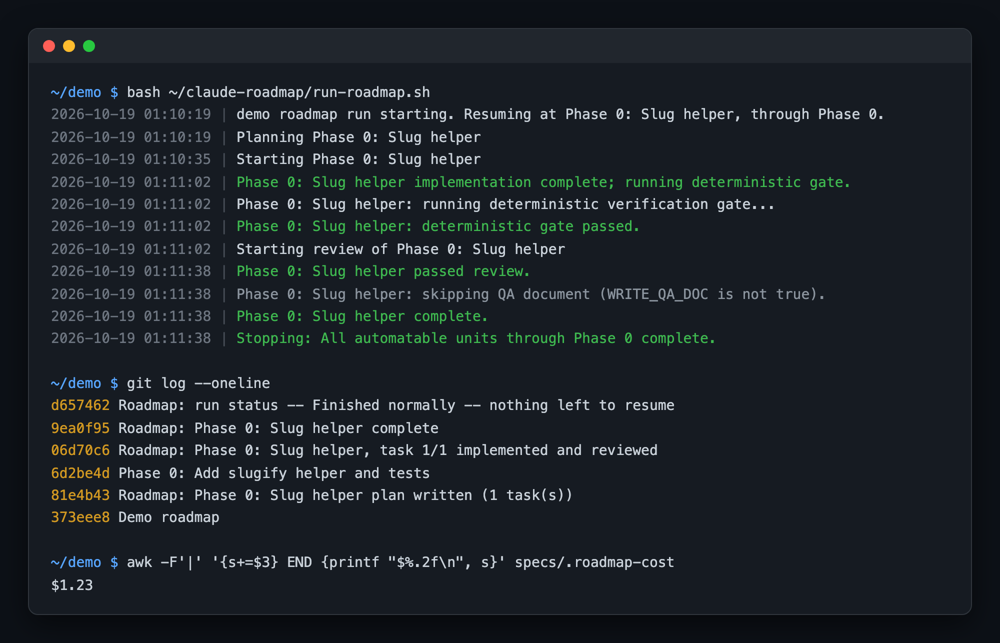
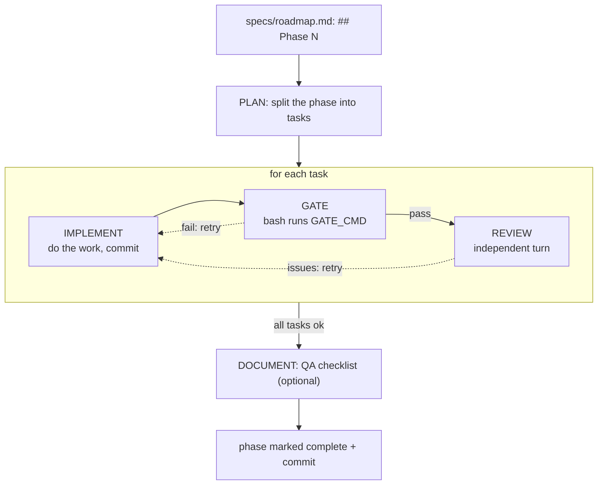

# claude-roadmap

A headless Claude Code runner that works through a repo's `specs/roadmap.md` phase by phase, unattended. A plain bash gate plus an independent reviewer check each turn's work, and of course every stage is a fresh Claude turn with no memory of the others. As of now, the roadmap (and attached spec files) are all created manually for each project, but I plan on adding a guided onboarding/interview session that generates them.



| File                                                     | What it is                                                                         |
| -------------------------------------------------------- | ---------------------------------------------------------------------------------- |
| [`run-roadmap.sh`](run-roadmap.sh)                       | Parses the roadmap, runs the stages, retries, resumes, notifies                    |
| [`roadmap-ctl.sh`](roadmap-ctl.sh)                       | Live control from a second terminal for status, stop, stop after task/phase, pivot |
| [`roadmap-stream-parse.js`](roadmap-stream-parse.js)     | Turns `claude -p` stream JSON back into a plain transcript                         |
| [`roadmap.config.example.sh`](roadmap.config.example.sh) | The per repo config every target repo copies and commits                           |
| `*.bat`                                                  | Windows launchers that find Git Bash instead of the WSL `bash` shim                |

## Architecture



- **Built to run overnight.** When quotas are hit, the runner automatically retries every 30 minutes. Non-quota based failures retry a bounded number of times, then stop. A killed run resumes exactly where it stopped, retry counters included. Every stop rewrites `specs/ROADMAP-RESUME.md` with what's needed to continue, and a turn that needs a human (a real API key, an account, a decision) stops the run and pings your phone through [ntfy](https://ntfy.sh) if you have it set up.
- **Cost is tracked.** Each turn's cost goes to `specs/.roadmap-cost`, progress and task plans are committed as it goes, and full transcripts land in `specs/.roadmap-run.log`.
- **QA Document.** Creates a detailed document of what changed, why and how. Provides a detailed step by step guide on how to QA and test each change, so that a human tester can validate as well as be up to date with the changes.

## Running locally

Requires the `claude` CLI, Node, git, curl and bash 4 or newer (on macOS: `brew install bash`).

In the target repo, copy [`roadmap.config.example.sh`](roadmap.config.example.sh) to `scripts/roadmap.config.sh`, set at least `REPO_DESCRIPTION` and `LAST_AUTOMATABLE_PHASE` (and usually `GATE_CMD`). Most of the times I just point my agent to this repo instead, it can easily perform the cloning and setup.

Add `.roadmap-runtime/` and `specs/.roadmap-run.log` to the target repo's `.gitignore`. Every variable is documented in the example config.

Then, from the target repo's root:

```bash
bash /path/to/claude-roadmap/run-roadmap.sh                 # start or resume a run
bash /path/to/claude-roadmap/roadmap-ctl.sh status          # from another terminal
bash /path/to/claude-roadmap/roadmap-ctl.sh stop-after-task # or stop, stop-after-phase, retry, pivot "text"
```

## Safety

Every turn runs with `--permission-mode bypassPermissions`, so it can do anything a normal `claude` session could do to the target repo. The reviewer is told not to edit code, but that's not really a sandbox. Run it only on a repo or branch you're fine having changed without review, and never point `GATE_CMD` at anything that provisions paid resources or touches production.
